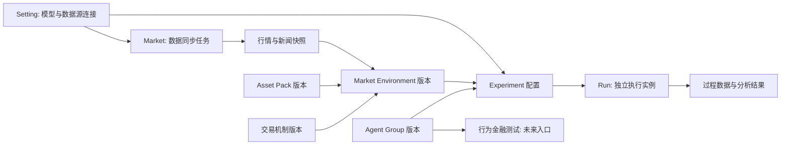
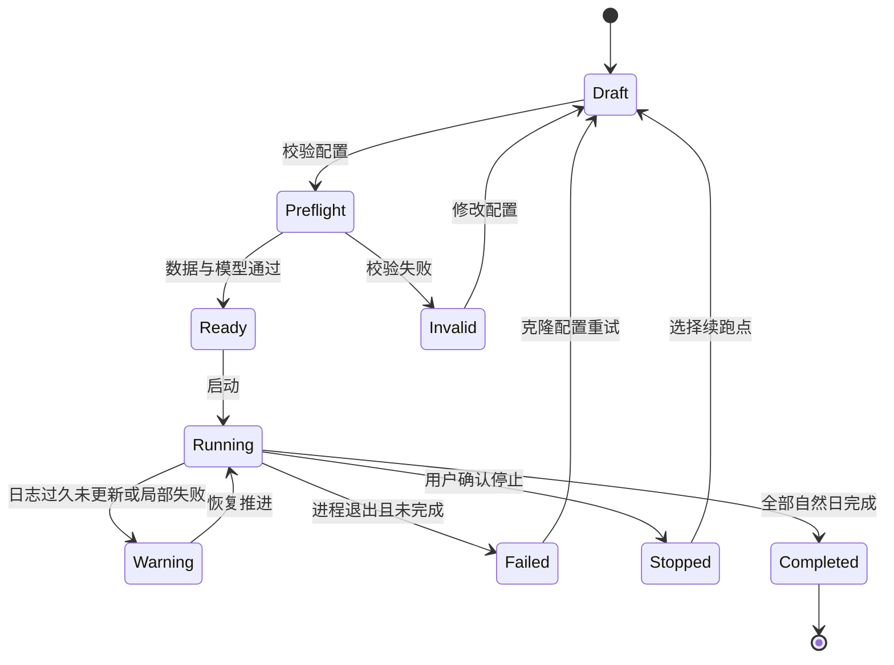

# TwinMarket 交互工作台 UI 设计文档

> 状态：设计提案  
> 日期：2026-09-12（四大工作空间修订）  
> 评估基线：TwinMarket 当前工作区代码；主分支提交 `3e1f5698d534768aa7d2187ef61e082f7df1a463` 为最初源码调研基线；只读原型实际锁定 npm `animal-island-ui@1.10.0`，两者接口不可混为一谈。

## 1. 结论

可以使用 `animal-island-ui` 构建 TwinMarket 的交互工作台，但应采用“业务壳层 + 专业可视化”的混合方案，而不是只依赖该组件库。

- **适合度**：表单、卡片、分页、状态反馈和抽屉等通用交互约 7/10；专业图表和复杂数据操作约 2/10；混合后整体可达到 8/10。
- **推荐边界**：用 `animal-island-ui` 负责导航外观、实验配置、运行状态、表格外壳、弹层和反馈；用 Apache ECharts 负责行情与统计图，用 AntV G6 负责用户关系网络；超大表格再用 TanStack Table 提供无样式的数据能力。
- **不建议替换现有论文主页**：当前 `index.html` 是项目介绍页。建议保留它，将新产品作为独立的 `/studio` 或单独前端应用，避免“论文展示”和“实验操作”混在同一信息架构中。
- **不是直接套组件即可完成**：当前模拟由 Python CLI 驱动，没有 Web API、任务管理器或结构化事件流。可交互 UI 需要一个薄的 Python 服务层。
- **许可证是上线前置条件**：`animal-island-ui` 使用 CC BY-NC 4.0，只允许非商业用途且要求署名。科研、评估和非商业展示可用；商业产品、企业项目或付费服务不可直接采用。

### 关于图标的更正

用户所述“没有图标组件”与本次核对的代码不再一致。需要区分仓库主分支和已发布版本：

- `Icon` 组件；
- 原先调研的主分支有 101 个内置原创线性图标；
- `name`、`icon` 和 `src` 三种接入方式；
- `ICON_LIST` 运行时清单；
- `size`、`color`、`strokeWidth` 和无障碍标签能力。

实际安装的 npm `1.10.0` 只声明 13 个 legacy `name`，其 `icon` 属性接收 `LucideIcon`，包本身依赖 `lucide-react`。因此原型通过一个 `glyph` 适配入口把 Lucide 图标交给框架 `Icon` 渲染，并显式锁定 Lucide 版本；不使用主分支的 101 图标清单来推断发布包能力。官方在线演示在原型验证时显示 `1.11.0`，仅作为视觉参考，原型未自动升级。

## 2. 当前产品与数据事实

### 2.1 当前交互形态

当前仓库实际上包含两套彼此独立的体验：

1. `index.html` 是静态论文/项目展示页，使用 Chart.js 和自绘 Canvas 展示示例内容；它不读取模拟运行数据。
2. `simulation.py` 是真实模拟入口，通过 CLI 参数启动；`script/monitor_simulation.py` 每 5 秒只读 SQLite、日志和产物目录，能够输出终端文本或 JSON 快照。

所以新 UI 的产品定位应是 **研究实验工作台**，而不是对当前静态主页做换肤。

### 2.2 数据分层

| 阶段 | 当前真实数据 | 主要来源 | UI 含义 |
| --- | --- | --- | --- |
| 初始化数据 | 日期范围、用户数、并发数、激活概率、技术交易者概率、关系图阈值、时间衰减、模型配置、belief、用户模板、行情、交易日历、新闻索引 | `simulation.py` 参数、YAML、CSV、SQLite、PKL/FAISS | 能否安全、可复现地启动实验 |
| 过程数据 | 当前自然日/交易日、完成到哪一天、用户处理、LLM 对话、关系图、发帖/互动、交易决策、撮合、数据库快照、产物数量、日志新鲜度和错误 | `simulation.log`、两个 SQLite、每日 JSON、图文件、`monitor_simulation.py` | 实验是否推进、卡在哪里、是否需要人工处理 |
| 结果数据 | 行情与技术指标、组合价值、收益、交易明细、成交汇总、大单净流入、订单簿、belief 演化、论坛内容、互动、动态图网络、模型对话与全部可复现产物 | `Profiles`、`StockData`、`TradingDetails`、论坛表、`simulation_results/`、records、graphs | 研究结论、机制解释、复现与导出 |

### 2.3 当前可直接读取的数据

初始化阶段已有的数据包括：

- `Profiles`：用户人口属性、行为金融分类、提示词、策略、初始与当前现金、持仓、资产、收益率；
- `Strategy`：每个用户的策略文本；
- `StockProfile`：10 类行业/市场指数及描述；
- `StockData`：收盘、昨收、涨跌、估值、成交量、均线、大单资金；
- belief CSV：`user_id`、长文本 belief、态度；
- `trading_days.csv`：自然日是否开市及上一交易日；
- 新闻 PKL 与 FAISS 索引；
- LLM 和 embedding 的 YAML 配置。

过程和结果阶段已有的数据包括：

- 每日 `trading_records`、`reaction_records`、`post_records`；
- 每个用户的 `conversation_records/YYYY-MM-DD/*.json`；
- 每日 NetworkX 图快照；
- `posts`、`reactions`、`post_references`；
- `daily_summary_{date}.csv`、`transactions_{date}.csv`、`large_order_flow_{date}.csv`；
- 每个股票/日期的订单簿文本和 JSON；
- 每日写入的用户画像、持仓、资产和行情快照。

### 2.4 不能从当前数据可靠得出的状态

当前监控器可以知道“日期、数据库最大时间、文件数、日志尾部”，但不能可靠知道每个用户正在执行哪一步、API 重试次数、单步耗时和等待队列。终端里的 `tqdm` 也没有持久化为结构化事件。

因此 UI 必须区分：

- **已观测状态**：文件或数据库已经写入的事实；
- **运行中推断**：根据日志和进程存活推测；
- **未知状态**：没有足够事件支持，不能伪造精确百分比。

建议后端新增 append-only JSONL 事件流，至少包含：

```json
{
  "ts": "2023-06-15T09:42:11",
  "run_id": "run_20230615_qwen3_001",
  "date": "2023-06-15",
  "stage": "agent_decision",
  "user_id": "10039126898",
  "status": "completed",
  "duration_ms": 18342,
  "attempt": 1,
  "message": "decision persisted"
}
```

## 3. 用户与设计目标

### 3.1 核心用户

- **实验研究者**：配置变量、启动批次、比较运行、导出论文数据；
- **算法开发者**：定位模型调用、解析、撮合和数据写入问题；
- **结果审阅者**：不启动任务，只浏览市场、行为和社交结果。

### 3.2 核心设计目标

1. 把一次实验从“拼命令”变成可校验、可复现的配置流程。
2. 让研究者在 10 秒内判断任务是正常、缓慢、卡住还是失败。
3. 从市场、个体行为、社会传播三个尺度解释结果。
4. 所有图都能回到原始表格、用户、日期和文件，避免只有漂亮图而无法审计。
5. 温暖、有辨识度，但不把金融研究界面做成玩具。

## 4. 信息架构与用户逻辑

系统包含四个一级工作空间：`Experiment`、`Agent`、`Market`、`Setting`。原文第 5–7 节的实验配置、监控和分析设计均属于 Experiment。`/studio` 仅是部署前缀，实际应用主路由保留用户指定的单数和大小写，例如 `/studio/Experiment`。

| 空间 | 用户要完成的事 | 管理对象 | 不在此处修改的内容 |
| --- | --- | --- | --- |
| Experiment | 创建、配置、查看、分析、管理市场模拟实验 | 实验草稿、资源版本绑定、运行实例、结果、产物 | 全局 Agent 模板、共享市场数据、连接密钥 |
| Agent | 创建、配置、管理 Agent Group；未来进行行为金融测试 | 群体及其成员、人设、策略、初始 belief、群体版本、测试方案 | 已运行实验中的每日持仓与 belief |
| Market | 管理交易机制、资产组合包、资产/新闻数据，创建市场环境 | 机制版本、资产包版本、数据快照、同步任务、环境版本 | 金融数据源凭据 |
| Setting | 配置语言模型、向量模型、金融数据源访问及未来全局选项 | 连接配置、默认模型、能力与访问状态、应用偏好 | 数据同步批次和实验特定参数 |

建议桌面端路由如下：

```text
/studio
├── /Experiment                         实验库
│   ├── /new                            选择群体、环境、模型与运行参数
│   └── /:experimentId
│       ├── /configuration              草稿配置或已冻结的配置
│       ├── /runs/:runId/live            某次运行总览
│       ├── /runs/:runId/agents          当次运行 Agent 状态与对话
│       ├── /runs/:runId/market          当次行情、订单与撮合
│       ├── /runs/:runId/social          当次论坛与网络
│       ├── /analysis                   结果与运行对比
│       └── /artifacts                  复现信息与产物
├── /Agent                              Agent Group 库
│   ├── /new                            创建或导入群体
│   ├── /groups/:groupId                 成员、画像、策略、belief 与版本
│   └── /behavior-tests                 行为金融测试（预留）
├── /Market                             市场环境库
│   ├── /environments/new               组合机制、资产包与数据快照
│   ├── /environments/:environmentId    环境详情、覆盖范围与版本
│   ├── /mechanisms                     可用交易机制及参数
│   ├── /asset-packs                    资产组合包
│   ├── /data                           行情、新闻数据集
│   └── /sync                           拉取、更新任务与质量检查
└── /Setting
    ├── /language-models                大语言模型连接与默认值
    ├── /embedding-models               向量模型、维度与索引兼容性
    ├── /financial-sources              外部金融数据源访问
    └── /general                        后续全局设置的分区入口
```

### 4.1 核心对象与版本绑定



Experiment 是研究配置的容器，Run 是一次执行。同一 Experiment 可保留多次重复运行；一期现有日志目录映射为“一实验、一运行”的旧数据导入形式。Agent Group 与 Market Environment 是独立可复用资源，实验启动时固定引用版本，并保存有效参数快照。改变群体、更新行情或更换全局默认模型只影响新草稿；历史实验的输入与结果保持可追溯。

模型连接保存可更新的凭据引用，manifest 只保存连接 ID、模型标识、推理参数与非敏感元数据，不保存 key。新实验显式采用哪个模型；全局默认值仅负责预填。

### 4.2 Agent 工作空间

| View | 主要内容与操作 | 组件与数据支持 |
| --- | --- | --- |
| Group Library | 群体名称、成员数、策略/态度分布、版本、被哪些实验使用；搜索、创建、导入、复制、归档 | Card、Table、Tag、Input；当前只有模板与运行内用户子集，没有 Group 注册表 |
| Group Editor | 来源选择、成员抽样、人数、画像与策略配置、belief 覆盖校验、差异复核 | 分步 Form、Table、Drawer；`prepare_simulation_run.py` 已提供固定排序子集准备能力，随机/分层抽样为新增 |
| Group Detail | 成员表、行为特征分布、策略、初始 belief、版本历史和引用实验 | ECharts 分布图 + Table；Profiles、Strategy、belief CSV 支持首版只读 |
| Member Inspector | 单个成员人设、策略、行为标签、初始 belief；提示词折叠查看 | Drawer + Tabs；初始资产配置需校验所绑定环境的资产代码 |
| Behavioral Tests | 测试任务入口、能力说明；未来涵盖处置效应、彩票偏好等实验方案和结果 | 首版标注“规划中”，不展示虚构测试分数或启用执行按钮 |

创建流程：选择/导入模板 → 确定成员 → 配置策略与 belief → 检查 ID 与字段覆盖 → 保存群体版本。Group 的身份特征与行为参数独立于市场；若继承当前模板的现金和持仓，标明其依赖的资产包。Experiment 创建时决定采用模板资产配置还是环境提供的初始禀赋，并检查代码、份额、现金和估值基准。

### 4.3 Market 工作空间

| View | 主要内容与操作 | 数据与边界 |
| --- | --- | --- |
| Environment Library/Detail | 机制、资产包、交易日历、行情/新闻快照、日期覆盖、版本、引用实验 | 新环境从已有资源组合，缺失任何必需项显示具体原因 |
| Mechanism Catalog/Detail | 撮合方式、价格限制、订单规则、费用、参数及实现状态 | 当前只确认 `matching_engine.py` 的日级价格/时间优先与最大成交量撮合；其他机制必须标“未实现” |
| Asset Pack Library/Detail | 指数/资产列表、行业、权重、描述与可用行情范围 | 当前 StockProfile 是 10 个行业指数；资产包是模拟可交易资产集合，不是某个 Agent 的投资组合 |
| Dataset Explorer | 行情预览、新闻覆盖、交易日历、来源、更新时间、质量与版本 | 原 I-3 中市场侧的数据源检查迁至此处；Group/belief 校验留在 Agent |
| Data Sync | 选择已配置连接、标的、日期、增量/全量策略，预估范围，拉取、校验、发布快照 | 当前无通用外部行情同步服务；只读原型展示本地库存，不主动发起收费或外部请求 |
| Environment Builder | 选择机制版本、资产包、数据版本与日历，检查日期交集，保存环境版本 | 环境供实验复用，实验设置具体开始/结束日期与运行资源 |

同步流程：选择 Setting 中的连接 → 指定资产/新闻范围 → 建立同步任务 → 暂存数据 → 查缺失/重复/单位/日期 → 发布新快照。同步失败不覆盖旧版本。新闻索引额外记录 embedding 模型、维度和语料版本；换模型或维度时产生新的索引版本，不能静默复用不兼容索引。

### 4.4 Setting 工作空间

采用固定二级分区，后续可以增加存储、显示、访问控制等项目，无须改变一级导航。

- **Language Models**：多个连接配置、provider、模型标识、服务地址、超时、默认值与访问状态；未来支持测试连接和能力校验。
- **Embedding Models**：模型连接、维度、批量能力、被哪些新闻索引使用及兼容性提示。
- **Financial Sources**：访问凭据、支持行情/新闻的能力、连接检测及配额信息（仅当上游提供）；实际拉取由 Market 管理。
- **General**：后续设置分区的空状态；首版只读原型可提供本地的视觉密度与刷新偏好。

“配置存在”与“连接测试通过”是不同状态；不因发现 YAML 文件就显示绿色在线。原型只返回允许公开的模型名与配置存在状态，不读取/回传密钥字段。

### 4.5 Experiment 的调整

创建实验向导调整为：选择 Agent Group 版本 → 选择 Market Environment 版本 → 选择模型并设置日期、激活率、并发等运行参数 → 预检与保存/启动。创建过程中缺少资源时可以跳转 Agent 或 Market，返回后保留草稿。

原 I-1 与 I-2 归属 Experiment；原 I-3 拆到 Agent 与 Market；P-1～P-5、R-1～R-6 仍然是 Experiment 中的局部视图。跨页面跳转保持 experimentId/runId，不能把实验内个体状态当成可编辑的 Group 模板，也不能把某次模拟生成的价格显示成 Market 中的外部行情源。

四个一级导航固定显示；进入实验后在页面内部显示“总览、Agent、市场、社交、结果”等二级导航，并保留面包屑中的实验名，以区分同名概念。

### 4.6 当前代码到产品对象的迁移

当前代码把人设、初始持仓、市场历史、运行结果混合存放在用户数据库中。产品层可以先加只读适配，不能宣称代码已经具有独立 Group/Environment/Connector 注册表。建议新增元数据层管理 ID、版本、来源、被引用关系；启动时再将选中的不可变版本组装到独立运行目录，逐步解耦原有格式。

第一版原型将已有 `logs_*` 目录标注为导入实验，将 `data/sys_1000.db` 标注为本地群体模板，将 StockProfile/StockData 与当前撮合实现标注为本地环境预览。尚未持久化的资源不显示虚构的版本号、同步成功记录或创建时间。

### 4.7 实验运行状态机

运行状态机：



界面上不提供“暂停”按钮，因为当前模拟没有可靠的暂停/恢复语义。只提供“停止”和“从副本续跑”，并明确停止的后果。

## 5. 初始化数据 Views

### I-1 实验列表 `RunLibraryView`

**目标**：选择已有实验、发现异常、创建新实验。

**内容**：

- 顶部：标题、数据源状态、`新建实验` 主按钮；
- 运行卡片：名称、状态、模型、用户数、日期范围、已完成交易日、最后更新时间；
- 筛选：运行状态、模型、创建时间；
- 行操作：打开、克隆配置、查看产物；删除不进入 MVP；
- 异常运行显示“日志多久未更新”，而不是笼统显示“运行中”。

**组件**：`Title`、`Card`、`Tag`、`Progress`、`Button`、`Select`、`DatePicker`、`Skeleton`、`Pagination`。

### I-2 新建实验 `NewRunWizardView`

使用 4 步向导；组件库没有 Stepper，需要自定义 `RunStepper`。

#### 第 1 步：资源版本（依据四空间设计修订）

先选择 Agent 中的群体版本和 Market 中的环境版本。以下文件清单作为选中资源的只读来源详情；需要编辑时跳转其所属工作空间。

- 用户模板数据库；
- belief CSV；
- 股票资料和历史行情；
- 交易日历；
- 新闻 PKL 与向量索引；
- 每项显示文件状态、大小、记录数、最大日期和校验结果。

浏览器不能直接安全访问任意本地路径，所以文件选择必须由本地后端提供白名单目录或原生文件选择器，不能把自由路径文本框直接传给 Python。

#### 第 2 步：市场与 Agent

- 开始/结束日期；
- 用户数 `node`；
- 激活概率 `activate_prob`；
- 技术交易者概率 `prob_of_technical`；
- 关系图相似度 `similarity_threshold`；
- 时间衰减 `time_decay_factor`；
- 顶级用户比例 `top_n_user`；
- 新运行/续跑模式。

概率字段采用 `Input` + 原生数字语义 + 百分比格式；不要使用自由文本。框架没有 Slider，MVP 不必补 Slider，因为精确数值更适合研究配置。

#### 第 3 步：模型与运行资源

- 聊天模型配置；
- 并发线程 `max_workers`；
- API 超时与重试策略（来自配置文件）；
- debug 开关；
- 输出目录和运行名称；
- “测试连接”按钮及延迟结果。

API key 只在后端写入或引用，前端永不回显完整值，运行快照和导出 manifest 必须脱敏。

#### 第 4 步：复核与预检

- 一页摘要展示所有参数；
- 校验日期是否落入可用行情与新闻范围；
- 校验用户数与数据库、belief 是否匹配；
- 校验输出目录为空或使用新名称；
- 校验模型连接；
- 显示预计 LLM 调用规模，而不是承诺完成时间；
- `开始模拟` 是此页唯一使用重 3D 阴影的主操作。

**组件**：`Form`、`FormItem`、`Input`、`Select`、`DatePicker`、`Switch`、`Radio`、`Collapse`、`Tag`、`Tooltip`、`Modal`、`Notification`、`Button`。

### I-3 数据源检查 `DataSourcesView`（迁入 Agent / Market）

**目标**：在不启动实验的情况下验证数据完整性。

- 数据集清单与版本/修改时间；
- SQLite 表记录数和日期边界；
- 10 个指数及其行业、权重、描述；
- belief 态度分布和缺失情况；
- 交易日/新闻覆盖热力图；
- FAISS 向量条数、维度、缺失新闻数；
- 校验错误可以定位到具体用户 ID、日期或文件。

**组件**：`Table` 外观可复用；排序、筛选和虚拟列表应由 TanStack Table 或自定义逻辑补足。

## 6. 过程数据 Views

### P-1 运行总览 `LiveRunOverview`

首屏只回答五个问题：任务是否活着、做到哪一天、当前在哪个阶段、错误是否增加、数据是否继续写入。

布局建议：

1. 顶栏：运行名、状态 Tag、当前模拟日期、交易日/休市日、最后心跳、停止按钮；
2. 进度区：交易日进度 + 自然日进度，两者必须分开；
3. KPI：用户数、已处理用户、交易数、帖子数、互动数、产物数；
4. `DailyPipeline`：关系图 → Agent 输入 → 决策落盘 → 发帖 → 撮合 → 论坛互动 → 日终快照；
5. 最近事件和告警；
6. 最近生成的产物快捷入口。

只有引入结构化事件后，才显示“本日用户 7/10”。否则显示“已落盘对话 9/10”，并标注指标来源。

### P-2 Agent 处理 `AgentExecutionView`

- Agent 状态矩阵：未激活、排队、处理中、重试、完成、失败；
- 可按用户类型、策略、态度、状态筛选；
- 行字段：用户 ID、Agent 类型、当前阶段、耗时、尝试次数、最后事件；
- 点击行打开 `Drawer`，查看画像、持仓、belief、决策、发帖和对话；
- 长对话按消息折叠，不一次渲染全部 1000 人内容；
- 错误展示摘要、发生阶段和关联日志，不向普通审阅者暴露堆栈噪音。

### P-3 市场与撮合 `LiveMarketView`

- 指数选择器；
- 收盘价、MA5/10/30 与真实行情基准对比；
- 成交量与大单净流入；
- 买卖/持有决策数量；
- 订单簿深度图；
- 当日成交表、有效/无效交易筛选；
- 涨跌停范围标记。

当前数据只有 `close`、`pre_close`，没有完整 OHLC，所以不得伪造 K 线。除非扩展数据源，否则使用折线图、区间带和成交量柱图。

### P-4 社交传播 `LiveSocialView`

- 动态关系网络；
- 当前节点/边数、连通分量、头部用户；
- 节点颜色表示 belief/态度，大小表示度数或影响力；
- 论坛时间线：帖子、点赞、取消点赞、转发和引用；
- 帖子类型 `type1/type2/type3` 过滤；
- 点击网络节点联动 Agent 抽屉和帖子列表。

NetworkX 的 PKL 必须由后端转换成受控 JSON；浏览器不直接解析 PKL。1000 节点时默认只显示骨干网络或分层聚合，允许用户再展开，避免一上来渲染“毛线团”。

### P-5 事件与诊断 `RunDiagnosticsDrawer`

- 结构化告警在前，原始日志在后；
- 日志新鲜度、进程 PID/退出码、最近 API 错误、超时与重试；
- 日志级别、阶段、用户、关键词过滤；
- `CodeBlock` 适合短日志片段，不适合持续流式大日志；大日志需要虚拟化的只读 viewer；
- “复制诊断摘要”不能包含 API key、完整系统提示词或私密模型端点凭据。

## 7. 结果数据 Views

### R-1 结果总览 `ResultOverview`

- 运行是否完整、完成范围、异常天数；
- 组合总价值、累计收益、回撤、交易量、成交率；
- 市场/Agent/社交三条摘要；
- 相比基准或另一运行的差异；
- 所有计算指标附数据口径和覆盖日期。

“市场定律验证率”等论文级指标当前没有统一产物，不能作为首版硬编码 KPI。应在后端增加明确的派生指标任务和版本号后再展示。

### R-2 市场动力 `MarketResultsView`

- 10 个指数的归一化价格折线；
- 价格、成交量、波动率、大单净流入小多图；
- 每日涨跌热力图；
- 模拟值与真实值偏差；
- 单指数详情：估值、均线、成交和订单簿；
- 图表框选时间后，下面的交易表与统计同步过滤。

### R-3 行为与 Belief `BehaviorResultsView`

- 用户收益分布和分位数；
- 用户类型/策略/态度分组对比；
- belief 演化趋势；
- 处置效应、彩票偏好、低分散、高换手等分组对收益和交易行为的影响；
- 从群体结论下钻到样本 Agent 的证据链：画像 → 信息 → 分析 → 决策 → 成交 → 后续 belief。

长文本 belief 的情绪或主题分类属于派生数据，必须保存分类模型、提示词或规则版本，不能在浏览器临时计算后当作事实。

### R-4 交易与组合 `TradingResultsView`

- 成交明细与未成交量；
- 买卖方向、目标价、成交价、原始数量和剩余数量；
- 用户持仓和现金随时间变化；
- 组合集中度、换手率和收益率；
- 无效订单原因分布；
- CSV 导出必须保留当前筛选条件说明。

### R-5 社交结果 `SocialResultsView`

- 每日关系图快照和时间滑块；
- 度数、中心性、社群和头部用户；
- 帖子与互动量时序；
- belief 分化/收敛；
- 事件、帖子传播和行情之间的时间对齐；
- 支持固定两个日期进行网络差异对比。

### R-6 产物与复现 `ArtifactsView`

- 按日期和类型浏览数据库、CSV、JSON、PKL、图片和日志；
- 每个产物显示大小、修改时间、校验和、生成阶段；
- 下载单文件或生成不含密钥的复现包；
- 展示运行参数、代码 commit、Python/依赖版本、模型名称和数据版本；
- PKL/SQLite 默认下载，不在浏览器中直接执行或信任内容。

## 8. 与 `animal-island-ui` 的适配矩阵

| 需求 | 框架能力 | 适配结论 | 设计决策 |
| --- | --- | --- | --- |
| 基础操作 | `Button` | 高 | 仅“开始模拟”“确认停止”等主动作使用 3D 主按钮 |
| 参数表单 | `Form`、`Input`、`Select`、`DatePicker`、`Switch`、`Radio`、`Checkbox` | 高 | 补数字输入、百分比格式、原生 `textarea` 的岛屿风封装 |
| 分组和折叠 | `Card`、`Title`、`Collapse`、`Divider` | 高 | 适合向导和详情；密集分析页少用花纹 Card |
| 页签 | `Tabs` | 中高 | 用于运行详情二级切换，不用作全局导航 |
| 状态反馈 | `Tag`、`Progress`、`Notification`、`Loading`、`Skeleton` | 高 | 为运行状态建立固定颜色/文案，不只靠颜色区分 |
| 弹层 | `Drawer`、`Modal`、`Tooltip` | 高 | Agent 详情用 Drawer；blob Modal 只用于短确认，不承载大表单 |
| 数据表 | `Table`、`Pagination` | 中 | 支持滚动与客户端分页；发布包声明 `fixed` 类型，但实现未找到相应固定列处理，不能承诺可用。排序、筛选、列显隐、虚拟化和服务端分页需补充 |
| 日志代码 | `CodeBlock` | 低到中 | 适合摘要；不支持大规模流式日志、行号和通用语法高亮 |
| 页面导航 | 无 Sidebar/Menu/Breadcrumb | 低 | 自建 `StudioShell`，只复用 tokens 和 Icon |
| 步骤/时间线 | 无 Stepper/Timeline | 低 | 自建 `RunStepper`、`DailyPipeline`、`EventTimeline` |
| KPI/统计卡 | 无 Statistic/Badge | 中 | 用 Card + 自定义排版，避免用 `Wallet` 表示普通指标 |
| 图表 | 无 | 无 | Apache ECharts 补充 |
| 图网络 | 无 | 无 | AntV G6 补充，简单 MVP 可先用 ECharts graph |
| 大数据表 | 基础 Table | 低 | TanStack Table 负责 headless 行为，岛屿样式负责视觉 |
| 图标 | npm 1.10.0 的 `Icon` + Lucide / legacy name / 图片 | 高 | 发布包以 Lucide 适配为主；101 原创图标属于原先调研的主分支，不能混用其 API |
| 响应式页面 | 组件可嵌入，但无完整 layout | 中 | 由应用层 CSS Grid/Container Queries 实现 |

### 主要技术适配成本

1. 当前前端是静态 HTML，需要新建 React + TypeScript + Vite 应用；
2. 需要薄后端管理 Python 子进程和只读数据查询；
3. `Table` 的客户端分页会把全量数据送到浏览器，不适合 1000 Agent × 多日记录；
4. 组件库样式导入会加载字体和全局 tokens，应先在独立 `/studio` 隔离，避免污染现有主页；
5. 组件库版本迭代快，应固定精确版本并做视觉回归测试；
6. CC BY-NC 4.0 与 TwinMarket 本身的 MIT 许可证不同，分发时必须单独保留组件库署名和许可证说明。

## 9. 视觉系统

### 9.1 风格原则

采用“温暖的研究岛屿”，不是“游戏化交易终端”：

- 页面背景使用暖白 `#f8f8f0`，内容面使用奶油色；
- 标题和正文使用暖棕，不用纯黑或冷灰；
- 交互圆角不小于 12px，主按钮/输入使用胶囊形；
- 3D 阴影只用于关键主操作；表格筛选、图表工具栏使用轻按钮；
- 装饰性点阵、彩带 Title 只用于入口和阶段标题，不覆盖图表绘图区；
- 正文使用 `Noto Sans SC`，数字和拉丁字符使用 `Nunito`；日志允许等宽字体。

### 9.2 页面密度

- 桌面设计基准宽度 1440px；左侧导航 232px，顶部状态栏 64px，内容最大宽度 1440px；
- 分析页采用 12 栏网格，卡间距 16px/24px；
- 表格行保持 44–52px，不为追求“可爱”无限放大控件；
- 关键图表最小高度 320px，网络图 520px；
- 长文本、对话和日志默认在 Drawer 中阅读，避免压缩主视图。

### 9.3 状态颜色与中国市场涨跌色

必须分离“系统状态”和“市场方向”：

- 系统成功：mint/teal；警告：amber；失败：coral；停止：brown；
- A 股上涨：暖红；下跌：柔绿；持平：暖棕灰；
- 每个涨跌值同时显示 `+/-`、箭头或文字，不能只靠红绿；
- 图表提供纹理/线型差异，照顾色觉缺陷用户。

## 10. 图标与图表补充方案

### 10.1 图标

以下是主分支调研时的映射参考，**不是 npm 1.10.0 的可导入清单**：

| 语义 | 内置图标 |
| --- | --- |
| 首页/运行库 | `Home`、`Folder` |
| 新建/启动 | `Plus`、`Play` |
| 配置 | `Settings`、`Edit`、`Save` |
| 数据与文件 | `File`、`Upload`、`Download`、`Search` |
| 日期与时间 | `Calendar`、`Clock`、`Countdown` 组件 |
| Agent 与社交 | `User`、`Chat`、`Share`、`Bell` |
| 查看与刷新 | `Eye`、`Refresh` |
| 结果与成就 | `Trophy` |

发布版原型统一采用 **Lucide React → animal-island-ui Icon**。导航使用 FlaskConical、Users、ChartNoAxesCombined、Settings2；数据库、活动、刷新等使用同一图标族。Lucide 支持 tree-shake，并可统一大小、颜色和描边粗细。

建立唯一入口 `TwinIcon`：

```tsx
type TwinIconName =
  | IslandIconName
  | 'trend'
  | 'database'
  | 'activity'
  | 'pause'
  | 'stop'
  | 'warning'
  | 'trade';

// 统一 20/24px、2.75 左右描边、round cap/join、currentColor；
// 按钮必须同时有文字，不能用图标猜测危险操作。
```

不要使用 emoji、Unicode 箭头、内联临时 SVG 或同时引入 Phosphor/Tabler/Font Awesome。专业品牌或彩色资产才使用 `Icon src`。

### 10.2 图表

**主推荐：Apache ECharts**

- 可覆盖折线、柱状、散点、箱线、热力、关系图和多坐标组合；
- 支持 Canvas/SVG、主题注册、数据缩放、brush、联动和图片导出；
- 大数据量使用 Canvas，小规模且需要清晰导出/无障碍时可使用 SVG；
- 用一个 `twinIslandTheme` 将字体、背景、tooltip、轴线、圆角和语义颜色统一。

**网络图推荐：AntV G6**

- 专门处理节点、边、布局、缩放、拖拽、选择和邻居高亮；
- 更适合 1000 Agent 关系网络及日期快照对比；
- MVP 如果只需要静态关系图，可先使用 ECharts graph 减少依赖；进入社群分析和复杂联动后再上 G6。

**当前 Chart.js 的位置**

现有主页已经加载 Chart.js，它适合静态宣传图和低复杂度折线/雷达图。如果交互工作台追求最低改造量，可以在只读 MVP 暂时复用；但订单簿联动、矩阵热图、复杂 tooltip、数据缩放和网络分析会很快碰到边界，所以长期不建议同时维护 Chart.js 与 ECharts 两套主题。

### 10.3 `twinIslandTheme` 图表规范

- 图表背景透明，外层由 `Card` 提供奶油底；
- 轴文字 `#8a7b66`，网格线使用暖米色虚线；
- tooltip 使用 16px 圆角、暖白背景和暖棕阴影；
- 主线 mint，比较线 amber/purple；市场涨跌使用专门红/绿；
- 线宽 2–3px，数据点默认隐藏，hover 后显示；
- 动画 150–300ms，并遵循 `prefers-reduced-motion`；
- 图表旁提供“查看数据表”，导出图必须带运行名、指标口径和日期范围。

## 11. 建议前后端结构

### 11.1 前端

- React 18 + TypeScript + Vite；
- `animal-island-ui@1.10.0` 固定精确版本并引入 `animal-island-ui/style`；
- React Router 管理路由；
- TanStack Query 管理服务端数据和轮询/SSE 后的缓存；
- ECharts；复杂网络阶段再增加 G6；
- TanStack Table 仅提供排序、筛选、分页、列状态和虚拟化逻辑，不带另一套视觉样式。

以上为生产实现建议。当前 `studio/` 只读原型为 React 19 + JSX + Vite，使用轻量 History 路由与可取消、禁止重叠请求的轮询 hook；使用语义化 HTML 表格实现服务端分页，避免把已分页数据再次交给客户端分页。Python 标准库 HTTPServer 仅监听本机，不导入或启动模拟引擎。后续产品化再迁移到 TypeScript、React Router、TanStack Query 与 FastAPI。

### 11.2 Python 服务层

推荐 FastAPI，与现有 Python 数据处理保持同一语言。第一阶段先做只读服务，第二阶段再开放启动/停止。

建议 API：

```text
GET  /api/runs
GET  /api/runs/{run_id}
GET  /api/runs/{run_id}/snapshot
GET  /api/runs/{run_id}/events              SSE
GET  /api/runs/{run_id}/agents
GET  /api/runs/{run_id}/agents/{user_id}
GET  /api/runs/{run_id}/market
GET  /api/runs/{run_id}/social-graph
GET  /api/runs/{run_id}/transactions
GET  /api/runs/{run_id}/artifacts
POST /api/runs/preflight
POST /api/runs
POST /api/runs/{run_id}/stop
```

服务端职责：

- 为每次运行生成不可变 `run_manifest.json`；
- 安全拼装命令并启动独立子进程，不接受任意 shell 字符串；
- 使用 SQLite read-only URI 查询运行中的数据库；
- 将 NetworkX PKL 转成限制字段的 JSON；
- 解析/写入结构化事件；
- 对分页、筛选和聚合做服务端处理；
- 脱敏 API key、端点凭据和不应公开的 prompt；
- 用 SIGINT 做可控停止并记录退出原因；
- 禁止两个进程写同一组数据库。

### 11.3 前端数据契约

快照至少包含：

```ts
type RunSnapshot = {
  runId: string;
  status: 'draft' | 'preflight' | 'ready' | 'running' | 'warning' | 'failed' | 'stopped' | 'completed';
  observedAt: string;
  startDate: string;
  endDate: string;
  currentDate: string | null;
  completedThrough: string | null;
  calendarDays: { completed: number; total: number };
  tradingDays: { completed: number; total: number };
  heartbeatAgeSeconds: number | null;
  currentStage: string | null;
  users: { total: number; completedToday: number | null; failedToday: number | null };
  counters: { trades: number; posts: number; reactions: number; conversations: number };
  warnings: RunWarning[];
};
```

所有数值带单位和口径；`null` 表示未知，不能替换成 0。

## 12. 响应式、无障碍与性能

### 响应式

- **≥1280px**：侧边栏常驻，图表 2 栏；
- **768–1279px**：侧栏收起为 Drawer，图表单栏或 8/4 分栏；
- **<768px**：只支持查看状态、告警和摘要，不在手机上创建复杂实验或分析 1000 节点网络；
- 表格在小屏使用卡片摘要 + 详情 Drawer，不强行压缩所有列。

### 无障碍

- 所有图标按钮必须有可见文字或 `aria-label`；
- 状态和涨跌不能只用颜色；
- Modal/Drawer 打开后管理焦点并支持 Escape；
- 图表提供数据表和文字摘要；
- 动画响应 `prefers-reduced-motion`；
- 焦点色遵循组件库的黄/teal 规则并满足对比度；
- 日志、长 belief 和对话支持键盘滚动、复制和跳到错误。

### 性能

- Agent 表和交易表使用服务端分页；超过 200 行启用虚拟化；
- 对话正文按需加载；
- SSE 只推事件与计数，图表数据按日期/指数请求；
- 1000 节点网络先聚合或只显示重要边，后台布局可缓存；
- ECharts 实例按可见区域挂载，离开 Tab 后暂停动画和更新。

## 13. 实施阶段

### Phase 0：许可证与原型决策

- 确认产品永久保持非商业研究用途；
- 在关于页和分发包保留 `animal-island-ui` 署名及 CC BY-NC 4.0；
- 若存在未来商业化可能，先取得额外授权或改用宽松许可的组件方案。

### Phase 1：只读可观测 MVP

- 新建独立 React `/studio`，一级导航为 Experiment、Agent、Market、Setting；
- Experiment 实验列表、运行总览、日志诊断、基础行情和交易表；
- Agent 浏览本地群体模板与成员，保留行为金融测试入口；
- Market 浏览已有机制、资产包与数据库存；Setting 浏览模型与数据源配置状态；
- 创建、配置、同步等写操作标注为后续能力，原型不会修改模拟输入和运行数据；
- 后端复用 `monitor_simulation.py` 的 JSON 快照逻辑；
- 先不从 UI 启动或停止任务，降低进程管理风险。

### Phase 2：配置与任务控制

- 新建实验向导、数据预检、模型连接测试；
- 运行 manifest、任务启动、停止和从副本续跑；
- 引入结构化事件流和逐 Agent 状态。

### Phase 3：研究分析

- 市场、行为、belief、交易、社交五类结果页；
- ECharts 联动、运行对比、G6 网络；
- 可复现包和指标版本管理。

### Phase 4：质量与扩展

- 1000 Agent 性能测试；
- 键盘、屏幕阅读器、色觉和 reduced motion 测试；
- 视觉回归；
- 再评估批量运行、实验队列和共享能力。

## 14. MVP 验收标准

1. 用户能在实验列表中识别正常、卡住、失败和完成任务；
2. 运行详情明确区分自然日与交易日进度；
3. 页面展示的每个计数都能追溯到日志、数据库或具体产物；
4. 未有结构化事件时不展示虚假逐用户百分比；
5. 用户能从市场图下钻到交易，再下钻到 Agent 决策和对话；
6. 1000 Agent 的表格不会一次渲染全部行；
7. 图表均有数据表或文字替代；
8. API key 和敏感配置不会出现在浏览器响应、日志复制或复现包；
9. 组件库署名与许可证信息可见；
10. `animal-island-ui`、ECharts 和补充图标在颜色、描边、圆角、字体和动效上表现为一个系统。

## 15. 主要风险与决策记录

| 风险 | 等级 | 处理 |
| --- | --- | --- |
| CC BY-NC 禁止商业使用 | 高 | Phase 0 必须确认用途；商业化则换库或取得授权 |
| 当前无 Web API/任务管理 | 高 | 先只读，再开放启动/停止；所有命令参数结构化 |
| 监控粒度不足 | 高 | 新增结构化事件流；UI 标明观测值与未知值 |
| 可爱视觉降低研究可信度 | 中 | 装饰只用于壳层，分析区保持克制和高密度 |
| 红涨绿跌与成功/失败冲突 | 中 | 市场与系统两套语义色，并辅以符号/文字 |
| Table 不适合大数据 | 中 | 服务端分页 + TanStack Table/虚拟化 |
| 图标/文档快速变化 | 中 | 固定精确版本，建立 `TwinIcon` 和视觉回归 |
| PKL/数据库直接暴露 | 中 | 后端受控解析，只返回 JSON 字段白名单 |
| 当前运行无法可靠暂停 | 中 | UI 不提供暂停，只提供确认停止和副本续跑 |

## 16. 四空间只读原型（已实现）

原型代码位于 `studio/`，入口 `/studio/Experiment`，保留根目录论文展示页。

| 空间 | 本版可浏览与交互 | 仍为规划 |
| --- | --- | --- |
| Experiment | 切换本地运行、参数快照、5 秒读取/暂停/手动刷新、日期快照、成员表/详情、行情曲线/数据表、日志摘要、产物数量 | 创建/启停、完整分析、社交图、对照实验 |
| Agent | 1,000 人本地模板、类型分布、搜索/分页、成员行为特征/持仓/策略 | 创建/编辑群体、版本管理、行为金融测试 |
| Market | 本地环境预览、机制说明、10 个行业指数、行情及文件库存 | 新建机制/资产包/环境、外部数据拉取/更新与快照发布 |
| Setting | 模型名称与配置存在性、接入流程说明、当前浏览器密度偏好 | 凭据管理、连接测试、全局配置保存 |

所有写入入口均打开“规划入口 · 不执行操作”说明，不调用任何写 API。API 使用只读 SQLite、白名单配置/事件提取，不反序列化 PKL，不触发 LLM 或金融数据请求。实际监控状态与页面读取状态分离，断连保留上次快照。

验证包括 Python 只读/路径/脱敏/日期状态测试、Chrome 四路由交互与轮询/断连检查、1440/1024/390 宽度截图。结果与限制见 `studio/README.md` 和 `studio/design-qa.md`。这验证了产品分区与阅读原型，不代表后端资源管理、长时间监控可靠性或完整实验分析已完成。

## 17. 参考资料

### TwinMarket 当前代码

- `simulation.py`：运行参数、每日流程和产物写入；
- `script/monitor_simulation.py`：当前只读运行快照；
- `trader/matching_engine.py`：撮合、每日汇总、成交、大单资金和订单簿；
- `util/UserDB.py`：用户画像、交易和 NetworkX 关系图；
- `util/ForumDB.py`：帖子、互动和引用；
- `data/sys_1000.db`：当前 SQLite 数据结构；
- `index.html`、`assets/js/charts.js`：现有静态项目页和示例图表。

### 外部项目与组件

- [animal-island-ui 仓库](https://github.com/guokaigdg/animal-island-ui)
- [animal-island-ui 设计系统](https://github.com/guokaigdg/animal-island-ui/tree/main/docs/design-system)
- [animal-island-ui 组件导出](https://github.com/guokaigdg/animal-island-ui/blob/main/src/index.ts)
- [animal-island-ui 许可证](https://github.com/guokaigdg/animal-island-ui/blob/main/LICENSE)
- [Apache ECharts](https://echarts.apache.org/en/)
- [AntV G6](https://g6.antv.vision/en/manual/introduction/)
- [Lucide](https://lucide.dev/)
